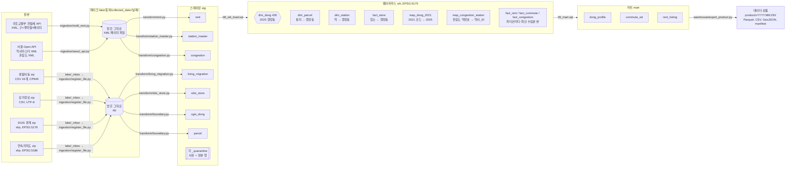

# 데이터 흐름: 원본에서 데이터 상품까지

이 문서는 "처음 받은 데이터가 어떤 모양이었고, 어떻게 레이크에 들어가고, 거기서 어떻게 꺼내 이어지는지"를 한 장으로 본다. 숫자는 2026-10-22 새벽(전월세 4주 백필 직후) DB와 레이크에서 직접 센 값이다. 규칙의 자세한 내용은 [rules.md](rules.md), 왜 그렇게 정했는지는 [decisions.md](decisions.md)에 있다.

비유로 먼저: **레이크**는 택배를 뜯지 않고 날짜별로 쌓아 두는 창고, **스테이징**은 상자를 뜯어 불량품을 따로 빼 두는 검수대, **웨어하우스**는 모든 물건에 같은 주소 체계(2025 행정동)를 붙이는 분류 선반, **마트**는 손님(부동산 플랫폼)이 바로 쓰게 묶은 진열대, **데이터 상품**은 그 진열대를 날짜 붙여 포장한 상자다.

## 1. 한눈에

Airflow가 화살표마다 일정을 건다: API는 매주 월요일, 생활이동은 매월 21일부터 파일 도착을 기다리고, 나머지 파일은 손으로 넣으면 실행한다. 스테이징 테이블이 바뀌면(Asset) `wh_load`가 자동으로 08을 돈다.

## 2. 출처별: 처음 모양 → 레이크 → 스테이징 → 웨어하우스 → 마트

| 출처 | 처음 받은 모양 | 레이크에 넣는 방법과 모양 | 스테이징 (정제·검증) | 웨어하우스 | 마트에서 쓰는 곳 |
|---|---|---|---|---|---|
| 전월세 (오피스텔, 연립다세대) | 공공데이터포털 API. 요청 단위 = 구(행안부 5자리, 강남 11680) × 계약월. UTF-8 한 줄 XML, 한 페이지 1,000건. 금액에 쉼표("3,000"), 법정동 이름 + 지번만 있고 좌표·동호 없음 | `molit_rent.py`가 페이지별로 받아 그대로 저장. `molit_{offi,rh}_rent/collected_date=D/{구}_{계약월}_p001.xml`. 일시 오류만 3회 재시도, 0건·오류 코드는 실패 | `rent.py`: 숫자·날짜 정리, 법정동 이름 → 법정동 코드(상가정보에서 만든 대응표) → **지번으로 PNU 19자리** 만들기, 규칙 V1~V9. 처리 단위 (출처, 수집일, 구, 계약월). `stg.rent` 121,019행 (수집일 2개, 계약월 202606~202610) | `dim_parcel`에서 PNU로 필지를 찾아 행정동을 얻음. `fact_rent` 뷰 = 처리 단위마다 가장 최근 수집분 (늦은 신고 반영) | `rent_listing`(신규 계약 한 건 = 한 행), `dong_profile`의 월세·전세 중앙값 |
| 역사마스터 | 서울 Open API. XML, 역 784개, 위도·경도(WGS84) | `seoul_api.py`가 그대로 저장. `seoul_station_master/collected_date=D/subwayStationMaster_p001.xml` | `station_master.py`: 좌표 범위 검사, 중복 검사. `stg.station_master` 784행 | `dim_station`: 4326 → 5179 변환, 행정동 경계에 공간 조인 | `dong_profile`의 가장 가까운 역, 거리 |
| 지하철 혼잡도 | 서울 Open API. XML 2페이지, 한 행 = 역 × 방향 × 요일구분, 시간대 39칸이 가로로 펼쳐짐. 역번호 3자리·4자리 섞임 | 위와 같음. `seoul_subway_congestion/collected_date=D/subwConfusion_p00N.xml` | `congestion.py`: 39칸을 세로로 풀기(한 행 = 역 × 방향 × 요일 × 30분). `stg.congestion` 65,169행 | `map_congestion_station` 282개: 역번호 0 채워 4자리 + 호선 일치, 특수번호 9001~9006 등 6개는 손 대응표. `fact_congestion` 뷰 | `dong_profile`의 평일 07~09시 최대 혼잡도 |
| 서울 생활이동 (행정동) | 열린데이터광장 파일. 한 달 zip 약 1.1GB, 안에 도착시간별 CSV 24개(풀면 6.3GB, 1억 4,118만 행). CP949, 10열. **2021년 행정동 코드 7자리**, 이동인구 3명 이하는 "*" | 손으로 받아 `lake/_inbox/living_migration/`에 넣으면 센서가 발견 → `register_file.py`가 zip 검사(`testzip`, 필수 파일 24개, sha256)만 하고 그대로 복사. `seoul_living_migration/collected_date=D/생활이동_행정동_YYYYMM.zip` | `living_migration.py`: zip을 풀지 않고 스트리밍으로 읽어 **출근 범위만**(HW, 월~금, 도착 07~09시, 출발·도착 모두 서울) 넣음. 240분 초과는 격리. `stg.living_migration` 1,230만 행 (3개월), 격리 26,832행 | `map_dong_2021` 426개: 2021 코드 → 2025 동 (앞 7자리 규칙 + 바뀐 동 8개 손 대응). `fact_commute` 뷰 | `commute_od`(출발 동 × 직장 동, 20~34세 가중 평균 이동 시간, 직선거리) |
| 상가(상권)정보 | 공공데이터포털 파일. zip 337MB, 안에 시도별 CSV. 서울 554,092행, UTF-8, 39열, 경도·위도, 행안부 행정동 코드, 법정동 코드 | inbox → `register_file.py`. `sbiz_store/collected_date=D/소상공인시장진흥공단_상가(상권)정보_20260630.zip` | `sbiz_store.py`: 필수 5종(편의점, 슈퍼, 약국, 내과·소아과, 세탁)만. `stg.sbiz_store` 30,394행. **같은 zip이 전월세의 법정동 코드표로도 쓰인다** | `fact_store`: 4326 → 5179, 행정동에 공간 조인. 업소가 가진 행안부 코드로 **통계청 ↔ 행안부 행정동 코드 대응을 다수결로 만듦**(426/426) | `dong_profile`의 업소 수와 ㎢당 밀도 |
| SGIS 행정동 경계 | 통계청 파일. zip 76MB, shp, EPSG:5179, UTF-8, 2025년 코드 8자리(통계청식, 강남 11230) | inbox → `register_file.py`. `sgis_boundary/collected_date=D/bnd_dong_00_2025_2Q.zip` | `boundary.py`: 좌표계 숫자 검사(.prj), 서울만, 꼬인 도형 `ST_MakeValid`. `stg.sgis_dong` 426행 | **`dim_dong` 426행: 모든 출처가 모이는 중심 축** | 모든 마트 테이블의 키 `dong_id`, `dong_boundary.geojson` |
| 연속지적도 | 브이월드 파일. zip 96MB, shp, **EPSG:5186**(경계와 다름), EUC-KR, 896,692 필지, PNU 중복 0 | inbox → `register_file.py`. `parcel_boundary/collected_date=D/LSMD_CONT_LDREG_서울.zip` | `boundary.py`: 좌표계 검사, `ST_MakeValid`. `stg.parcel` 896,692행 | `dim_parcel`: 필지 안 대표점(`ST_PointOnSurface`)을 5179로 바꿔 행정동에 넣음. 동에 안 들어간 필지 19개 | 전월세 → 행정동 연결에만 쓰임 (직접 내보내지 않음) |

레이크에는 있지만 처리하지 않는 출처: 지하철 시간대별·일별 승하차, 버스 시간대별 승하차, 버스정류소 위치, BIS 정류장, 단독·다가구 전월세. 단계 1에서 탐색했지만 승인된 질문의 지표에 쓰이지 않는다(결정 6). 탐색 결과는 [data_sources.md](data_sources.md).

## 3. 층마다 지키는 규칙

| 층 | 규칙 | 왜 |
|---|---|---|
| 수집 → 레이크 | 받은 바이트를 그대로 저장, 절대 수정하지 않음. 경로에 수집일. 같은 날 다시 받으면 임시 폴더에 받은 뒤 바꿔 넣음. 손 파일은 sha256이 같으면 아무것도 안 하고, 다르면 실패 | 정제 규칙이 틀려도(예: 산 지번) 레이크에서 다시 만들 수 있다. 같은 날 두 번 돌려도 결과가 같다 |
| 레이크 → 스테이징 | 처리 단위마다 지우고 다시 넣기를 한 트랜잭션으로. 어긋난 행은 버리지 않고 `_quarantine`에 사유(`reasons`)와 원본(`raw`)으로. **파일 단위 실패**: 스키마 변경, 0건, 격리 5% 초과, 이전보다 10% 넘게 줄어듦 | 몇 번을 다시 돌려도 같은 결과(멱등). 조용히 빠지는 행이 없다 |
| 스테이징 → 웨어하우스 | 08 전체가 한 트랜잭션. 좌표는 모두 EPSG:5179(미터)로. 구조 검사(대응 안 된 코드, 행안부 코드 없는 동 등)에 걸리면 `RAISE`로 멈추고 이전 상태 유지 | 코드 체계 4가지(행안부 시군구, 통계청 2021, 통계청 2025, 역번호)와 좌표계 3가지(4326, 5179, 5186)를 하나로 맞추는 곳이다 |
| 웨어하우스 → 마트 | 09 전체가 한 트랜잭션. 전월세는 25개 구 × 2개 출처가 모두 들어온 계약월만 | 구마다 기간이 달라 비교가 틀어지는 것을 막는다 |
| 마트 → 데이터 상품 | 날짜 버전 폴더, 파일마다 행 수와 sha256, 원천 기준일과 품질 지표를 manifest에 | 받는 쪽이 무엇을 받았는지 검증할 수 있다([data_contract.md](data_contract.md)) |

## 4. 거래 한 건 따라가기

강남구 오피스텔 월세 한 건이 끝까지 어떻게 바뀌는지 (실제 값):

1. **원본 (API 응답 XML의 item 하나)**
   `<deposit>3,000</deposit> <monthlyRent>160</monthlyRent> <excluUseAr>47.96</excluUseAr> <sggCd>11680</sggCd> <umdNm>역삼동</umdNm> <jibun>832-5</jibun> <dealYear>2026</dealYear><dealMonth>9</dealMonth><dealDay>18</dealDay> <contractType>신규</contractType> ...`
   좌표도 행정동도 없다. 시군구 코드는 행안부식이다.
2. **레이크**: `lake/molit_offi_rent/collected_date=2026-10-21/11680_202609_p001.xml` (이 요청의 전체 243건 중 3번째)
3. **스테이징 `stg.rent`**: deposit 3000, monthly_rent 160, deal_date 2026-09-18, excl_area 47.96, 그리고 **PNU `1168010100108320005`**
   - 1168010100 = 강남구 역삼동 법정동 코드 (상가정보 대응표에서 "11680 + 역삼동"으로 찾음)
   - 1 = 일반 지번 (산이면 2)
   - 0832 = 본번
   - 0005 = 부번
4. **웨어하우스**: `dim_parcel`에서 그 PNU의 필지를 찾는다. 필지 안 대표점이 들어가는 경계는 **통계청 2025 행정동 11230640 역삼1동**이고, 행안부 코드는 11680640이다. `fact_rent` 뷰는 같은 처리 단위를 나중에 다시 받으면 새 수집분으로 바꿔 보여 준다.
5. **마트 `rent_listing`**: dong_id 11230640, 역삼1동, 월세, 보증금 3000, 월세 160, 47.96㎡ 한 행
6. **데이터 상품**: `product/v2026.10.22/rent_listing.parquet`의 한 행. 받는 쪽이 "보증금 3,000 이하, 월세 80 이하"로 거르면 이 건은 빠진다(월세 160).

같은 방식으로 출퇴근은 "생활이동 2021 코드 1123064 → `map_dong_2021` → 2025 역삼1동"으로, 역과 업소는 "위경도 → 5179 점 → 경계 안에 들어가는 동"으로 같은 `dong_id`에 모인다.

## 5. 코드 체계가 만나는 곳

| 출처 | 동 코드 | 시군구 예 (강남) | 행정동으로 가는 길 |
|---|---|---|---|
| 전월세 | 없음 (법정동 이름 + 지번) | 11680 (행안부) | 지번 → PNU → 필지 → 공간 조인 |
| 상가정보 | 행안부 행정동 8자리 + 좌표 | 11680 | 좌표 → 공간 조인. 행안부 코드는 다수결로 `dim_dong.mois_dong_cd`가 됨 |
| 생활이동 | 통계청 2021, 7자리 | 11230 (통계청) | `map_dong_2021` |
| SGIS 경계 | 통계청 2025, 8자리 | 11230 | 그 자체가 `dim_dong` |
| 역사마스터, 혼잡도 | 역사_ID, 역번호 + 좌표 | 없음 | 좌표 → 공간 조인. 혼잡도는 `map_congestion_station`으로 역사_ID에 이음 |
