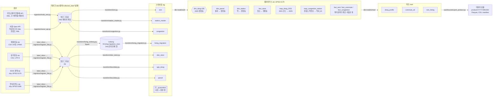
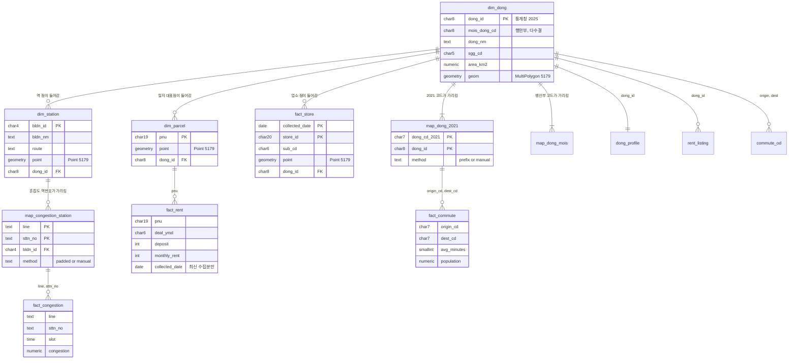

# 데이터 흐름: 원본에서 데이터 상품까지

이 문서는 "처음 받은 데이터가 어떤 모양이었고, 어떻게 레이크에 들어가고, 거기서 어떻게 꺼내 이어지는지"를 한 장으로 본다. 1~5절은 구조, 6절은 출처별 실제 데이터, 7절은 조인, 8절은 받는 쪽이 받는 파일, 9절은 케이스 3개, 10절은 층별 스키마다. 숫자는 2026-10-22 새벽(전월세 4주 백필 직후) DB와 레이크에서 직접 센 값이다. 규칙의 자세한 내용은 [rules.md](rules.md), 왜 그렇게 정했는지는 [decisions.md](decisions.md)에 있다.

비유로 먼저: **레이크**는 택배를 뜯지 않고 날짜별로 쌓아 두는 창고, **스테이징**은 상자를 뜯어 불량품을 따로 빼 두는 검수대, **웨어하우스**는 모든 물건에 같은 주소 체계(2025 행정동)를 붙이는 분류 선반, **마트**는 손님(부동산 플랫폼)이 바로 쓰게 묶은 진열대, **데이터 상품**은 그 진열대를 날짜 붙여 포장한 상자다.

## 1. 한눈에



Airflow가 화살표마다 일정을 건다: API는 매주 월요일, 생활이동은 매월 21일부터 파일 도착을 기다리고, 나머지 파일은 손으로 넣으면 실행한다. 스테이징 테이블이 바뀌면(Asset) `wh_load`가 dbt 빌드(웨어하우스 → 마트, 테스트) → 스키마 교체 → 내보내기를 차례로 돈다(결정 30~32). 그래서 매주 월요일 전월세 수집이 끝나면 그날 날짜의 상품 버전이 저절로 나온다.

## 2. 출처별: 처음 모양 → 레이크 → 스테이징 → 웨어하우스 → 마트

| 출처 | 처음 받은 모양 | 레이크에 넣는 방법과 모양 | 스테이징 (정제·검증) | 웨어하우스 | 마트에서 쓰는 곳 |
|---|---|---|---|---|---|
| 전월세 (오피스텔, 연립다세대) | 공공데이터포털 API. 요청 단위 = 구(행안부 5자리, 강남 11680) × 계약월. UTF-8 한 줄 XML, 한 페이지 1,000건. 금액에 쉼표("3,000"), 법정동 이름 + 지번만 있고 좌표·동호 없음 | `molit_rent.py`가 페이지별로 받아 그대로 저장. `molit_{offi,rh}_rent/collected_date=D/{구}_{계약월}_p001.xml`. 일시 오류만 3회 재시도, 0건·오류 코드는 실패 | `rent.py`: 숫자·날짜 정리, 법정동 이름 → 법정동 코드(상가정보에서 만든 대응표) → **지번으로 PNU 19자리** 만들기, 규칙 V1~V9. 처리 단위 (출처, 수집일, 구, 계약월). `stg.rent` 121,019행 (수집일 2개, 계약월 202606~202610) | `dim_parcel`에서 PNU로 필지를 찾아 행정동을 얻음. `fact_rent` 뷰 = 처리 단위마다 가장 최근 수집분 (늦은 신고 반영) | `rent_listing`(신규 계약 한 건 = 한 행), `dong_profile`의 월세·전세 중앙값 |
| 역사마스터 | 서울 Open API. XML, 역 784개, 위도·경도(WGS84) | `seoul_api.py`가 그대로 저장. `seoul_station_master/collected_date=D/subwayStationMaster_p001.xml` | `station_master.py`: 좌표 범위 검사, 중복 검사. `stg.station_master` 784행 | `dim_station`: 4326 → 5179 변환, 행정동 경계에 공간 조인 | `dong_profile`의 가장 가까운 역, 거리 |
| 지하철 혼잡도 | 서울 Open API. XML 2페이지, 한 행 = 역 × 방향 × 요일구분, 시간대 39칸이 가로로 펼쳐짐. 역번호 3자리·4자리 섞임 | 위와 같음. `seoul_subway_congestion/collected_date=D/subwConfusion_p00N.xml` | `congestion.py`: 39칸을 세로로 풀기(한 행 = 역 × 방향 × 요일 × 30분). `stg.congestion` 65,169행 | `map_congestion_station` 282개: 역번호 0 채워 4자리 + 호선 일치, 특수번호 9001~9006 등 6개는 손 대응표. `fact_congestion` 뷰 | `dong_profile`의 평일 07~09시 최대 혼잡도 |
| 서울 생활이동 (행정동) | 열린데이터광장 파일. 한 달 zip 약 1.1GB, 안에 도착시간별 CSV 24개(풀면 6.3GB, 1억 4,118만 행). CP949, 10열. **2021년 행정동 코드 7자리**, 이동인구 3명 이하는 "*" | 손으로 받아 `lake/_inbox/living_migration/`에 넣으면 센서가 발견 → `register_file.py`가 zip 검사(`testzip`, 필수 파일 24개, sha256)만 하고 그대로 복사. `seoul_living_migration/collected_date=D/생활이동_행정동_YYYYMM.zip` | `living_iceberg.py`(Spark): zip을 컨테이너 /tmp에 풀어 24시간대 전체 행을 글자 그대로 Iceberg 표에 넣음(대상연월 파티션, 줄 번호 보존). `living_migration.py`: Iceberg에서 **출근 범위만**(HW, 월~금, 도착 07~09시, 출발·도착 모두 서울) 가져와 정제. 240분 초과는 격리. `stg.living_migration` 4,038만 행 (10개월, 202510~202607), 격리 93,880행 | `map_dong_2021` 426개: 2021 코드 → 2025 동 (앞 7자리 규칙 + 바뀐 동 8개 손 대응). `fact_commute` 뷰 | `commute_od`(출발 동 × 직장 동, 20~34세 가중 평균 이동 시간, 직선거리) |
| 상가(상권)정보 | 공공데이터포털 파일. zip 337MB, 안에 시도별 CSV. 서울 554,092행, UTF-8, 39열, 경도·위도, 행안부 행정동 코드, 법정동 코드 | inbox → `register_file.py`. `sbiz_store/collected_date=D/소상공인시장진흥공단_상가(상권)정보_20260630.zip` | `sbiz_store.py`: 필수 5종(편의점, 슈퍼, 약국, 내과·소아과, 세탁)만. `stg.sbiz_store` 30,394행. **같은 zip이 전월세의 법정동 코드표로도 쓰인다** | `fact_store`: 4326 → 5179, 행정동에 공간 조인. 업소가 가진 행안부 코드로 **통계청 ↔ 행안부 행정동 코드 대응을 다수결로 만듦**(426/426) | `dong_profile`의 업소 수와 ㎢당 밀도 |
| SGIS 행정동 경계 | 통계청 파일. zip 76MB, shp, EPSG:5179, UTF-8, 2025년 코드 8자리(통계청식, 강남 11230) | inbox → `register_file.py`. `sgis_boundary/collected_date=D/bnd_dong_00_2025_2Q.zip` | `boundary.py`: 좌표계 숫자 검사(.prj), 서울만, 꼬인 도형 `ST_MakeValid`. `stg.sgis_dong` 426행 | **`dim_dong` 426행: 모든 출처가 모이는 중심 축** | 모든 마트 테이블의 키 `dong_id`. 도형 자체는 상품에 넣지 않는다(결정 26) |
| 연속지적도 | 브이월드 파일. zip 96MB, shp, **EPSG:5186**(경계와 다름), EUC-KR, 896,692 필지, PNU 중복 0 | inbox → `register_file.py`. `parcel_boundary/collected_date=D/LSMD_CONT_LDREG_서울.zip` | `boundary.py`: 좌표계 검사, `ST_MakeValid`. `stg.parcel` 896,692행 | `dim_parcel`: 필지 안 대표점(`ST_PointOnSurface`)을 5179로 바꿔 행정동에 넣음. 동에 안 들어간 필지 19개 | 전월세 → 행정동 연결에만 쓰임 (직접 내보내지 않음) |

레이크에는 있지만 처리하지 않는 출처: 지하철 시간대별·일별 승하차, 버스 시간대별 승하차, 버스정류소 위치, BIS 정류장, 단독·다가구 전월세. 단계 1에서 탐색했지만 승인된 질문의 지표에 쓰이지 않는다(결정 6). 탐색 결과는 [data_sources.md](data_sources.md).

## 3. 층마다 지키는 규칙

| 층 | 규칙 | 왜 |
|---|---|---|
| 수집 → 레이크 | 받은 바이트를 그대로 저장, 절대 수정하지 않음. 경로에 수집일. 같은 날 다시 받으면 임시 폴더에 받은 뒤 바꿔 넣음. 손 파일은 sha256이 같으면 아무것도 안 하고, 다르면 실패 | 정제 규칙이 틀려도(예: 산 지번) 레이크에서 다시 만들 수 있다. 같은 날 두 번 돌려도 결과가 같다 |
| 레이크 → 스테이징 | 처리 단위마다 지우고 다시 넣기를 한 트랜잭션으로. 어긋난 행은 버리지 않고 `_quarantine`에 사유(`reasons`)와 원본(`raw`)으로. **파일 단위 실패**: 스키마 변경, 0건, 격리 5% 초과, 이전보다 10% 넘게 줄어듦 | 몇 번을 다시 돌려도 같은 결과(멱등). 조용히 빠지는 행이 없다 |
| 스테이징 → 웨어하우스 | 08 전체가 한 트랜잭션. 좌표는 모두 EPSG:5179(미터)로. 구조 검사(대응 안 된 코드, 행안부 코드 없는 동 등)에 걸리면 `RAISE`로 멈추고 이전 상태 유지 | 코드 체계 4가지(행안부 시군구, 통계청 2021, 통계청 2025, 역번호)와 좌표계 3가지(4326, 5179, 5186)를 하나로 맞추는 곳이다 |
| 웨어하우스 → 마트 | 09 전체가 한 트랜잭션. 전월세는 25개 구 × 2개 출처가 모두 들어온 계약월만 | 구마다 기간이 달라 비교가 틀어지는 것을 막는다 |
| 마트 → 데이터 상품 | 날짜 버전 폴더, 파일마다 행 수와 sha256, 원천 기준일과 품질 지표를 manifest에 | 받는 쪽이 무엇을 받았는지 검증할 수 있다([data_contract.md](data_contract.md)) |

## 4. 거래 한 건 따라가기

강남구 오피스텔 월세 한 건이 끝까지 어떻게 바뀌는지 (실제 값):

1. **원본 (API 응답 XML의 item 하나)**
   `<deposit>3,000</deposit> <monthlyRent>160</monthlyRent> <excluUseAr>47.96</excluUseAr> <sggCd>11680</sggCd> <umdNm>역삼동</umdNm> <jibun>832-5</jibun> <dealYear>2026</dealYear><dealMonth>9</dealMonth><dealDay>18</dealDay> <contractType>신규</contractType> ...`
   좌표도 행정동도 없다. 시군구 코드는 행안부식이다.
2. **레이크**: `lake/molit_offi_rent/collected_date=2026-10-21/11680_202609_p001.xml` (이 요청의 전체 243건 중 3번째)
3. **스테이징 `stg.rent`**: deposit 3000, monthly_rent 160, deal_date 2026-09-18, excl_area 47.96, 그리고 **PNU `1168010100108320005`**
   - 1168010100 = 강남구 역삼동 법정동 코드 (상가정보 대응표에서 "11680 + 역삼동"으로 찾음)
   - 1 = 일반 지번 (산이면 2)
   - 0832 = 본번
   - 0005 = 부번
4. **웨어하우스**: `dim_parcel`에서 그 PNU의 필지를 찾는다. 필지 안 대표점이 들어가는 경계는 **통계청 2025 행정동 11230640 역삼1동**이고, 행안부 코드는 11680640이다. `fact_rent` 뷰는 같은 처리 단위를 나중에 다시 받으면 새 수집분으로 바꿔 보여 준다.
5. **마트 `rent_listing`**: dong_id 11230640, 역삼1동, 월세, 보증금 3000, 월세 160, 47.96㎡ 한 행
6. **데이터 상품**: `product/v2026.10.22/rent_listing.parquet`의 한 행. 받는 쪽이 "보증금 3,000 이하, 월세 80 이하"로 거르면 이 건은 빠진다(월세 160).

같은 방식으로 출퇴근은 "생활이동 2021 코드 1123064 → `map_dong_2021` → 2025 역삼1동"으로, 역과 업소는 "위경도 → 5179 점 → 경계 안에 들어가는 동"으로 같은 `dong_id`에 모인다.

## 5. 코드 체계가 만나는 곳

| 출처 | 동 코드 | 시군구 예 (강남) | 행정동으로 가는 길 |
|---|---|---|---|
| 전월세 | 없음 (법정동 이름 + 지번) | 11680 (행안부) | 지번 → PNU → 필지 → 공간 조인 |
| 상가정보 | 행안부 행정동 8자리 + 좌표 | 11680 | 좌표 → 공간 조인. 행안부 코드는 다수결로 `dim_dong.mois_dong_cd`가 됨 |
| 생활이동 | 통계청 2021, 7자리 | 11230 (통계청) | `map_dong_2021` |
| SGIS 경계 | 통계청 2025, 8자리 | 11230 | 그 자체가 `dim_dong` |
| 역사마스터, 혼잡도 | 역사_ID, 역번호 + 좌표 | 없음 | 좌표 → 공간 조인. 혼잡도는 `map_congestion_station`으로 역사_ID에 이음 |

## 6. 실제 데이터 모양: 원본 → 스테이징

모두 레이크 파일과 DB에서 그대로 뽑은 값이다. 긴 행은 일부 칸만 보였다.

### 전월세 (API XML의 item 하나 → `stg.rent` 한 행)
```xml
<item><buildYear>2006</buildYear><contractType>신규</contractType><dealDay>18</dealDay><dealMonth>9</dealMonth>
<dealYear>2026</dealYear><deposit>3,000</deposit><excluUseAr>47.96</excluUseAr><floor>3</floor><jibun>832-5</jibun>
<monthlyRent>160</monthlyRent><offiNm>역삼디오슈페리움</offiNm><sggCd>11680</sggCd><sggNm>강남구</sggNm><umdNm>역삼동</umdNm>...</item>
```
```
stg.rent: source_type=offi | sgg_cd=11680 | deal_ymd=202609 | deal_date=2026-09-18 | pnu=1168010100108320005
          deposit=3000 | monthly_rent=160 | excl_area=47.96 | floor=3 | build_year=2006 | contract_type=신규
          collected_date=2026-10-21 | source_file=11680_202609_p001.xml | item_no=3
```
바뀐 것: 쉼표 숫자 → 정수, 연·월·일 세 칸 → 날짜 하나, 법정동 이름 + 지번 → PNU, 출처 추적 칸(수집일, 파일, 순번) 추가.

### 생활이동 (zip 안 CSV, CP949 → `stg.living_migration`)
```
생활이동_행정동_2026.07_08시.csv
대상연월,요일,도착시간,출발 행정동 코드,도착 행정동 코드,성별,나이,이동유형,평균 이동 시간(분),이동인구(합)
202607,월,08,1121068,1123064,F,25,HE,43,*
202607,월,08,1121068,1123064,F,25,HW,227,100.11
202607,월,08,1121068,1123064,F,25,WW,70,*
202607,월,08,1121068,1123064,F,30,HW,212,98.56
```
`1121068`은 2021 코드로 관악구 신사동, `1123064`는 역삼1동이다. 이동유형 H = 야간상주지, W = 주간상주지, E = 기타. 이동인구 3명 이하는 `*`.
```
stg.living_migration (HW만 남김, *는 NULL):
target_ym | weekday | arrive_hour | origin_cd | dest_cd | sex | age | avg_minutes | population
202607    | 월      | 8           | 1121068   | 1123064 | F   | 25  | 227         | 100.11
202607    | 월      | 8           | 1121068   | 1123064 | F   | 30  | 212         | 98.56
202607    | 월      | 8           | 1121068   | 1123064 | M   | 20  | 43          | 12.1
```

### 지하철 혼잡도 (API XML 한 행, 가로 39칸 → 세로)
```
원본: DOW_SE=평일 LINE=1호선 STTN_NO=150 DPTRE_STTN=서울역 UP_DOWN_SE=상선
      TIME0530=8.3 TIME0600=20.8 ... TIME0700=37.4 TIME0730=65.8 TIME0800=72.3 TIME0830=95.7 ... TIME0030=1.4
stg.congestion:
dow  | line  | sttn_no | sttn_no4 | sttn_nm | direction | slot  | congestion
평일 | 1호선 | 150     | 0150     | 서울역  | 상선      | 07:00 | 37.4
평일 | 1호선 | 150     | 0150     | 서울역  | 상선      | 07:30 | 65.8
평일 | 1호선 | 150     | 0150     | 서울역  | 상선      | 08:00 | 72.3
평일 | 1호선 | 150     | 0150     | 서울역  | 상선      | 08:30 | 95.7
```
세로로 풀어 두면 "평일 07~09시 최댓값" 같은 계산이 `WHERE slot BETWEEN ... GROUP BY`로 끝난다.

### 역사마스터 (API XML → `stg.station_master`)
```
BLDN_ID=0222 BLDN_NM=강남 ROUTE=2호선 LAT=37.497990 LOT=127.027912
```
역사_ID는 문자 4자리로 둔다("0150"의 앞 0을 지키려고).

### 상가정보 (zip 안 CSV 39열 → `stg.sbiz_store`)
```
상가업소번호=MA010120220813191142 상호명=GS25역삼상록점 상권업종소분류코드=G20405 상권업종소분류명=편의점
시군구코드=11680 행정동코드=11680640 행정동명=역삼1동 법정동코드=1168010100 법정동명=역삼동
지번코드=1168010100107030003 경도=127.043994256178 위도=37.5040812614413 (나머지 26열 생략)
```
`stg.sbiz_store`에는 필수 5종만 14열(store_id, store_name, sub_cd, sub_nm, sgg_cd, adm_cd, bjd_cd, lon, lat 등)로 남긴다. 지번코드가 PNU와 같은 19자리 구조라는 것도 이 파일에서 알았다(측정 4).

### SGIS 경계, 연속지적도 (shp → `stg.sgis_dong`, `stg.parcel`)
```
SGIS   속성: BASE_DATE=20250630 ADM_CD=11230640 ADM_NM=역삼1동
       도형: POLYGON 303점, 첫 점 (958680.43, 1943487.58)   ← EPSG:5179 미터
       .prj: PROJCS["Korea_2000_Korea_Unified_Coordinate_System", ...
지적도 속성: PNU=1168010100108320005 JIBUN="832-5 대" COL_ADM_SE=11680
       도형: POLYGON 5점, 첫 점 (202709.14, 543642.67)      ← EPSG:5186 미터
       .prj: PROJCS["Korea 2000 / Central Belt 2010", ...
```
같은 강남인데 좌표 숫자가 전혀 다르다(958,680 vs 202,709). 좌표계가 달라서다. 그래서 `.prj`를 숫자로 검사하고, 웨어하우스에서 5179 하나로 맞춘다.

## 7. 조인: 서로 다른 기준을 하나의 행정동으로

| # | 무엇을 | 조인 키 / 방법 | 결과 |
|---|---|---|---|
| J1 | 필지 → 행정동 | 공간: 필지 안 대표점을 5186 → 5179로 바꿔 경계 안에 드는지 | 896,692 중 896,673 붙음 (19개는 경계 밖) |
| J2 | 전월세 → 필지 | 등호: `pnu` | 전월세 한 건 → 행정동 |
| J3 | 업소, 역 → 행정동 | 공간: 경위도(4326) → 5179 점 → 경계 안 | 업소 30,394 모두, 서울 안 역 401 / 784 |
| J4 | 통계청 동 ↔ 행안부 동 코드 | 다수결: J3으로 동에 붙은 업소들이 가진 행안부 코드 중 가장 많은 것. 어느 동의 1위도 아닌 코드는 업소가 가장 많은 동에 | 대표 코드 426 / 426, 대응표 427행. 대표 코드 이름 대조 425 / 426 같음(용신동 = 신설동 + 용두동) |
| J5 | 생활이동 2021 코드 → 2025 동 | 규칙 `code || '0'` + 손 대응 8행 | 규칙 418 + 손 8 |
| J6 | 혼잡도 역번호 → 역사_ID | `lpad(역번호, 4, '0')` + 호선 같음 + 손 대응 6행 | 276 + 6 |
| J7 | 행정동 → 가장 가까운 역 | KNN: `ORDER BY s.point <-> 대표점 LIMIT 1` (GiST 인덱스) | 426개 동 모두 |

### J1. 필지 → 행정동 (dbt `models/wh/dim_parcel.sql`)
```sql
INSERT INTO wh.dim_parcel (pnu, point, dong_id, source_collected_date)
SELECT p.pnu, p.point, d.dong_id, p.collected_date
FROM (SELECT pnu, collected_date, ST_Transform(ST_PointOnSurface(geom), 5179) AS point
      FROM stg.parcel WHERE collected_date = (SELECT max(collected_date) FROM stg.parcel)) p
LEFT JOIN wh.dim_dong d ON ST_Contains(d.geom, p.point);
```
```
pnu                 | x(5179)  | y(5179)   | dong_id  | dong_nm
1168010100108320005 | 958530.4 | 1943766.5 | 11230640 | 역삼1동
```
대표점을 `ST_Centroid`(무게중심)가 아니라 `ST_PointOnSurface`로 잡는 이유: ㄷ자 모양 필지는 무게중심이 필지 밖, 때로는 옆 동에 떨어진다(결정 16). `LEFT JOIN`이라 경계 밖 필지 19개도 사라지지 않고 `dong_id`가 빈 채로 남는다.

### J2. 전월세 → 행정동 (dbt `models/mart/rent_listing.sql`)
```sql
FROM wh.fact_rent r
JOIN wh.dim_parcel p USING (pnu)
JOIN wh.dim_dong d ON d.dong_id = p.dong_id
WHERE r.contract_type = '신규' AND r.deal_ymd IN (SELECT deal_ymd FROM rent_months);
```
전월세에는 좌표가 없다. 그래서 지번으로 PNU를 만들고(스테이징), PNU로 필지를 찾고(J2), 필지는 이미 행정동을 알고 있다(J1). 거래마다 공간 연산을 하지 않고 필지 89만 개에 한 번만 한다.

### J3, J4. 업소 → 행정동, 그리고 행안부 코드 다수결 (dbt `models/wh/fact_store.sql`, `map_dong_mois.sql`, `dim_dong.sql`)
```sql
SELECT p.*, d.dong_id FROM store_point p LEFT JOIN wh.dim_dong d ON ST_Contains(d.geom, p.point);   -- J3

SELECT dong_id, mois_dong_cd, count(*) AS stores,
       count(*)::numeric / sum(count(*)) OVER (PARTITION BY dong_id) AS share,
       row_number() OVER (PARTITION BY dong_id ORDER BY count(*) DESC, mois_dong_cd) AS rank      -- J4
FROM store_in_dong WHERE dong_id IS NOT NULL GROUP BY dong_id, mois_dong_cd;
```
```
통계청 동 | 업소가 가진 행안부 코드 | 업소 수 | 비율
역삼1동   | 11680640               | 373     | 0.989   ← 채택
역삼1동   | 11680580               | 3       | 0.008
역삼1동   | 11680521               | 1       | 0.003
용신동    | 11230515               | 90      | 0.536   ← 채택, 하지만 약함
용신동    | 11230533               | 78      | 0.464
```
GS25역삼상록점 하나로 보면: 경위도 (127.0440, 37.5041) → 5179 점 (959695.7, 1945076.8) → 역삼1동(통계청 11230640). 업소가 원래 가진 행안부 코드 11680640과 같은 동이다.

### J5. 생활이동 2021 코드 → 2025 동 (dbt `models/wh/map_dong_2021.sql`, 손 대응표 `seeds/map_dong_2021_manual.csv`)
```sql
INSERT INTO wh.map_dong_2021 VALUES ('1123074', '11230511', 'manual'), ...;   -- 일원2동 → 개포3동 등 8행
INSERT INTO wh.map_dong_2021 (dong_cd_2021, dong_id, method)
SELECT c.code, d.dong_id, 'prefix' FROM (...생활이동에 나온 코드...) c
JOIN wh.dim_dong d ON d.dong_id = c.code || '0';
```
```
1123064 → 11230640 역삼1동 (prefix)
1123051 → 11230510 신사동  (prefix)
1123074 → 11230511 개포3동 (manual)   ← 2025 코드를 앞 7자리로 자르면 1123051이 되어 신사동과 부딪친다
1125052 → 11250760 상일1동 (manual)   ← 한 동이 둘로 나뉨: 같은 값을 두 동에 복사 (copied_from_2021_split_dong = true)
1125052 → 11250770 상일2동 (manual)
```
2025 → 2021로 자르지 않고 2021 → 2025로 `'0'`을 붙이는 방향이라 충돌이 없다.

### J6. 혼잡도 역번호 → 역사_ID (dbt `models/wh/map_congestion_station.sql`, 손 대응표 `seeds/congestion_station_manual.csv`)
```sql
JOIN wh.dim_station s ON s.bldn_id = lpad(c.sttn_no, 4, '0') AND s.route = c.line;
```
```
1호선 150  → 0150 서울역 (padded)
2호선 222  → 0222 강남   (padded)
2호선 9001 → 0211 성수   (manual, 원본 이름 성수E)   ← 9001은 역사마스터에서 광역급행철도 역 ID라 번호만으로 이으면 틀린 역에 붙는다
```

### J7. 가장 가까운 역 (dbt `models/mart/dong_station.sql`)
```sql
CROSS JOIN LATERAL (SELECT s.* FROM wh.dim_station s ORDER BY s.point <-> c.p LIMIT 1) a
```
```
역삼1동 대표점에서: 역삼(2호선) 400m, 강남(2호선) 418m, 강남(신분당선) 480m
```

### 집계: 출퇴근 가중 평균 (dbt `models/mart/commute_od.sql`)
```sql
sum(population * avg_minutes) FILTER (WHERE age IN ('20','25','30') AND population IS NOT NULL)
  / NULLIF(sum(population) FILTER (WHERE age IN ('20','25','30') AND population IS NOT NULL), 0) AS avg_minutes_age20_34
```
생활이동의 한 행은 "이 성별·나이 묶음의 평균 시간"이다. 그냥 평균하면 3명짜리 행과 100명짜리 행이 같은 무게가 되므로 이동인구로 가중한다. 최근 6개 대상연월(결정 36) × 평일 × 07~09시 × 성별 × 나이의 행들이 출발·직장 동 한 쌍으로 모인다.
```
관악구 신사동 → 역삼1동: avg_minutes_age20_34 152.9 (이동인구 8,542.14), 전체 나이 116.4, distance_km 10.13
```

## 8. 서빙: 받는 쪽이 받는 것

```
product/v2026.10.23/
├─ manifest.json            1.8KB   버전, 파일별 행 수와 sha256, 원천 기준, 품질
├─ dong_profile.parquet     41KB    426행     (csv 73KB)
├─ commute_od.parquet       1.8MB   131,035행 (csv 11.4MB)
├─ rent_listing.parquet     402KB   50,696행  (csv 4.4MB)
└─ dong_mois_map.parquet    11KB    427행     (csv 19KB)
```
경계 도형(geojson)은 v2026.10.22까지 있었지만 SGIS 이용약관 때문에 v2026.10.23부터 뺐다(결정 26).
Parquet는 타입(날짜, 소수)을 지키고 같은 내용의 csv보다 1.8~11배 작다(dong_profile 73KB → 41KB, rent_listing 4.4MB → 401KB). csv는 엑셀로 바로 열어 보는 사람을 위해 같이 준다(UTF-8 BOM).

### manifest.json (일부)
```json
"sources": { "rent_months": "202606,202607,202608,202609", "rent_collected_date": "2026-10-22",
             "commute_months": "202605,202606,202607", "boundary_base_date": "2025-06-30", ... },
"quality": { "rent_quarantine_rows": "3", "commute_quarantine_rows": "26832",
             "dongs_without_mois_code": "0", "dongs_without_monthly_rent_deal": "15", ... }
```

### 파일마다 한 행
```
dong_profile (역삼1동):
  dong_id=11230640 mois_dong_cd=11680640 dong_nm=역삼1동 sgg_cd=11230 area_km2=2.360
  monthly_deals=582 monthly_median_deposit_10k_won=2000 monthly_median_rent_10k_won=95
  jeonse_deals=129 jeonse_median_deposit_10k_won=25200
  nearest_station_nm=역삼 nearest_station_route=2호선 nearest_station_distance_m=400 am_peak_congestion=76.5
  convenience_store=152 pharmacy=85 laundry=47 convenience_store_per_km2=64.4 ...

commute_od (관악구 신사동 → 역삼1동):
  origin_dong_id=11210680 dest_dong_id=11230640 avg_minutes=152.9 basis=age20_34
  population_age20_34=8542.14 distance_km=10.13 copied_from_2021_split_dong=false target_months=202605,202606,202607

rent_listing (역삼1동, 2026-09-18 계약 중 하나):
  dong_id=11230640 dong_nm=역삼1동 source_type=offi lease_type=월세 deal_date=2026-09-18
  deposit_10k_won=3000 monthly_rent_10k_won=160 excl_area_m2=47.96 floor=3 build_year=2006

dong_mois_map (용신동):
  mois_dong_cd=11230515 dong_id=11060810 dong_nm=용신동 is_primary=true  stores=90 share=0.536   (상가정보 이름: 신설동)
  mois_dong_cd=11230533 dong_id=11060810 dong_nm=용신동 is_primary=false stores=78 share=0.464   (상가정보 이름: 용두동)
```

### 받는 쪽이 쓰는 방법
`dong_id`로 파일을 잇는다. 플랫폼이 행안부 코드를 쓰면 `dong_mois_map`으로 `dong_id`를 찾는다(용신동은 행안부 코드 둘이 같은 dong_id로 간다). 사용자 입력(직장, 예산, 한도)을 받아 거르고 정렬하는 일은 받는 쪽이 한다. 예는 [warehouse/sql/demo.sql](../warehouse/sql/demo.sql):
1. 직장 동을 `dong_profile`에서 찾는다.
2. `rent_listing`을 예산·면적으로 걸러 동별 건수와 중앙값을 낸다.
3. `commute_od`에서 직장 동으로 가는 행 중 `avg_minutes <= 한도 OR distance_km <= 3`을 남긴다.
4. `dong_profile`의 역, 혼잡도, 편의를 붙여 보여 준다.

## 9. 케이스 3개 (2026-10-22 02시 마트 기준, `demo.sql`의 params만 바꿈)

공통: 직선거리 3km 이내면 이동 시간과 관계없이 통과(결정 23), 예산 안 신규 계약 3건 이상, 계약월 202606~202609. 정렬은 직선거리 순.

### 케이스 1. 강남 역삼1동 직장, 월세 보증금 3,000 / 월세 80 이하, 40㎡ 이하, 50분
결과 **21개 동** (이동 시간으로 통과 8, 3km로만 통과 13). 앞 5개:

| 동 | 이동 시간(분) | 직선거리(km) | 예산 안 계약 | 월세 중앙값 | 가까운 역 | 혼잡도(%) |
|---|---|---|---|---|---|---|
| 역삼1동 | 148.7 | 0.00 | 42 | 70 | 역삼 400m | 76.5 |
| 역삼2동 | 100.1 | 1.15 | 21 | 66 | 선릉 706m | 88.3 |
| 서초2동 | 88.7 | 1.25 | 9 | 72 | 양재(서초구청) 742m | 50.8 |
| 도곡1동 | 68.3 | 1.38 | 7 | 66 | 매봉 613m | 58.4 |
| 반포1동 | 79.2 | 1.45 | 21 | 63 | 사평 204m | 93.2 |

월세 중앙값이 가장 낮은 곳: 서빙고동 30(계약 3건), 장충동 54(47건), 방배3동 60(8건). 서빙고동은 건수가 적어 중앙값을 믿기 어렵다. 장충동은 건수가 많고 싸지만 6.66km 떨어져 있어 이동 시간(49.0분)으로 통과했다.

### 케이스 2. 여의도 여의동 직장, 전세 보증금 2억 5천만 원 이하, 50㎡ 이하, 50분
결과 **31개 동** (이동 시간으로 10, 3km로만 21). 앞 5개:

| 동 | 이동 시간(분) | 직선거리(km) | 예산 안 계약 | 전세 보증금 중앙값 | 가까운 역 | 혼잡도(%) |
|---|---|---|---|---|---|---|
| 여의동 | 153.3 | 0.00 | 16 | 22,250 | 여의나루 341m | 94.9 |
| 용강동 | 79.7 | 1.84 | 21 | 22,100 | 마포 359m | 92.7 |
| 신길1동 | 149.0 | 1.96 | 17 | 18,000 | 대방 493m | 123.2 |
| 영등포동 | 92.6 | 2.02 | 151 | 19,420 | 영등포시장 231m | 107.5 |
| 신수동 | 79.2 | 2.06 | 20 | 21,350 | 광흥창(서강) 410m | 54.0 |

영등포동은 예산 안 전세가 151건으로 가장 많고, 여의동보다 중앙값이 2,830만 원 낮다. 하지만 아침 혼잡도가 107.5%다. 비슷한 거리의 신수동은 54.0%다. 보증금 중앙값이 가장 낮은 곳은 신월4동(8,000, 7건)이다.

### 케이스 3. 가산디지털단지 가산동 직장, 월세 보증금 1,000 / 월세 60 이하, 33㎡ 이하, 40분
결과 **17개 동, 모두 3km 규칙으로만 통과** (이동 시간 40분 이하로 통과한 동 0). 앞 5개:

| 동 | 이동 시간(분) | 직선거리(km) | 예산 안 계약 | 월세 중앙값 | 가까운 역 | 혼잡도(%) |
|---|---|---|---|---|---|---|
| 가산동 | 148.0 | 0.00 | 101 | 55 | 가산디지털단지 640m | 102.8 |
| 가리봉동 | 66.6 | 0.84 | 7 | 50 | 남구로 355m | 95.8 |
| 독산1동 | 131.6 | 1.27 | 48 | 52.5 | 독산 417m | 102.8 |
| 구로3동 | 70.3 | 1.28 | 25 | 50 | 남구로 615m | 95.8 |
| 독산3동 | 58.5 | 1.63 | 16 | 55 | 구로디지털단지 1,097m | 77.8 |

이동 시간으로 통과한 동이 없는 이유: 가산동으로 가는 경로 425개 중 이동 시간 40분 이하는 3개, 50분 이하는 18개이고 중앙값이 77.6분이다. 그 3개 동에는 이 예산 안의 계약이 3건 미만이다. 역삼1동(중앙값 98.9분)과 여의동(90.9분)도 비슷하다. **한도를 40분처럼 낮게 잡으면 생활이동 이동 시간만으로는 거의 아무 동도 남지 않는다.** 결정 23의 직선거리 보완 없이는 이 질문에 답할 수 없다는 실측이고, 대중교통 길찾기 시간(결정 23의 C)이 다음 버전 과제인 이유다.

세 케이스에서 함께 보이는 것:
- 직장 동 자신으로 가는 이동 시간이 148~153분으로 가장 길다(근거리 직행 제외, 경유 포함. 데이터 계약 6절 1).
- 월세 계약은 보증금 중앙값이 대부분 1,000만 원이다. 동네 비교는 월세 중앙값으로 하는 것이 낫다.
- 예산 안 계약이 3~9건인 동은 중앙값이 흔들린다. 받는 쪽은 건수(`deals_in_budget`)를 함께 보여 주는 것이 좋다.

## 10. 스키마: 층마다 데이터를 어떻게 정리했나

DB(`information_schema`, `pg_constraint`, `geometry_columns`)에서 그대로 뽑았다. 행 수와 크기는 2026-10-22 백필 직후 값. 스테이징 DDL 원문은 `warehouse/sql/01~06`, 웨어하우스·마트는 `warehouse/dbt/models/`. 2026-11-03부터 wh·mart의 기본키·외래키·CHECK는 DB 제약이 아니라 dbt 테스트로 검사한다(결정 31 E2). 아래 표의 "기본키 / 외래키"는 그 테스트가 지키는 규칙이다.

### 층마다 다른 정리 원칙

| | 스테이징 `stg` | 웨어하우스 `wh` | 마트 `mart` |
|---|---|---|---|
| 모양 | 출처 하나 = 테이블 하나 + 격리 테이블 하나. 출처의 칸을 거의 그대로, 타입만 정함 | 행정동 차원(`dim_dong`)을 가운데 둔 별 모양. 차원(dim), 대응표(map), 사실(fact) | 받는 쪽 질문에 맞춘 넓은 표. 조인 없이 바로 읽힘 |
| 키 | 기본키가 **수집일로 시작**한다. 같은 원본을 다른 날 다시 받아도 나란히 쌓이고, 처리 단위(수집일 …)로 지우고 다시 넣는다 | 코드 하나(`dong_id`, `pnu`, `bldn_id`)가 기본키. 수집일은 키에서 빠지고 "어느 수집분에서 왔나"(`source_collected_date`)로만 남는다 | 기본키 제약은 두지 않고 dbt 테스트(`models/mart/mart.yml`, `tests/`)로 중복과 행 수를 확인한다 |
| 위치 | 원본 좌표계 그대로(경계 5179, 지적도 5186, 역·업소는 위경도 숫자) | **모두 EPSG:5179 점·면**. GiST 인덱스 | 도형 없음. 거리(m, km)와 면적(㎢)만 숫자로 |
| 추적 | 모든 행에 `source_file`과 파일 안 순번(`row_no`/`item_no`). 격리 행은 `reasons text[]` + 원본 `raw jsonb` | 대응표에 `method`(prefix/padded/manual)와 `note` | `basis`, `copied_from_2021_split_dong`, `target_months` 같은 출처 설명 칸 |
| 단위 | 원본 단위 | 원본 단위 | **컬럼 이름에 단위**: `_10k_won`(만 원), `_m2`, `_m`, `_km`, `_per_km2` |

### 관계 그림


`fact_rent`, `fact_commute`, `fact_congestion`은 테이블이 아니라 **뷰**다. 스테이징에 수집일별로 쌓인 행 중 처리 단위마다 가장 최근 수집분만 보여 준다(결정 18의 스냅샷 교체). 그래서 늦게 들어온 신고는 다시 받는 것만으로 웨어하우스에 반영된다.

### 스테이징 `stg`

| 테이블 | 한 행 | 기본키 | 컬럼 (NN = NOT NULL) | 행 수 | 크기 |
|---|---|---|---|---|---|
| `rent` | 수집일 × 신고된 전월세 계약 한 건 | **없음** (아래 설명) | source_type NN, collected_date NN, source_file NN, item_no NN, deal_ymd char(6) NN, sgg_cd char(5) NN, umd_nm NN, bjd_cd char(10) NN, jibun NN, **pnu char(19) NN**, building_name, house_type, build_year int, floor int, excl_area numeric(7,2) NN, deal_date date NN, deposit int NN, monthly_rent int NN, contract_type, contract_term, pre_deposit int, pre_monthly_rent int, use_rr_right | 121,019 | 32MB |
| `living_migration` | 수집일 × 대상월 × 출발 × 도착 × 요일 × 도착시 × 성별 × 나이 | (collected_date, target_ym, dest_cd, origin_cd, weekday, arrive_hour, sex, age) | dest_cd/origin_cd char(7), weekday char(1), arrive_hour smallint, sex char(1), age char(2), avg_minutes smallint NN, population numeric (가려진 `*`는 NULL), source_file, row_no | 40,382,009 | 8,100MB |
| `congestion` | 수집일 × 요일 × 호선 × 역 × 방향 × 30분 | (collected_date, dow, line, sttn_no, direction, slot) | sttn_no text(원본), **sttn_no4 char(4)**(0 채움), sttn_nm, slot time, congestion numeric(5,1) | 65,169 | 24MB |
| `station_master` | 수집일 × 역(호선별) | (collected_date, bldn_id) | bldn_id char(4), bldn_nm, route, lat/lot numeric(9,6) | 784 | 0.3MB |
| `sbiz_store` | 수집일 × 업소 (필수 5종) | (collected_date, store_id) | base_ym, store_id char(20), store_name, sub_cd char(6), sub_nm, sido_cd, sgg_cd, adm_cd char(8), bjd_cd char(10), lon/lat double | 30,394 | 16MB |
| `sgis_dong` | 수집일 × 행정동 | (collected_date, adm_cd) | base_date date, adm_cd char(8), adm_nm, made_valid bool, geom MultiPolygon **5179** | 426 | 7.6MB |
| `parcel` | 수집일 × 필지 | (collected_date, pnu) | base_ym, pnu char(19), jibun, sgg_cd, made_valid bool, geom MultiPolygon **5186** | 896,692 | 338MB |
| `*_quarantine` (6개) | 격리된 원본 행 하나 | 없음 | 출처 키 칸(수집일, 파일, 순번 등) + **reasons text[] + raw jsonb** + quarantined_at | rent 4, living 93,880, 나머지 0 | |

정리 방식에서 볼 것:
- **코드는 모두 문자형**(`char(4)`, `char(8)`, `char(19)`)이다. 숫자로 두면 역사_ID "0150"이나 PNU의 앞자리가 사라진다(CLAUDE.md 7절의 앞자리 0 문제).
- `stg.rent`에 기본키가 없는 것은 일부러다. 동·호가 없어 거래 하나를 가리킬 키가 없고, 같은 칸 값의 계약이 실제로 두 건일 수 있다. 그래서 처리 단위(출처, 수집일, 구, 계약월)를 통째로 지우고 넣고, 웨어하우스는 최신 수집분만 본다(결정 18).
- `living_migration`이 가장 크다(8.1GB, 10개월, 전체의 대부분). 원본 한 달 1억 4천만 행 중 출근 범위만 남겨 한 달 약 350만~430만 행이다. 원본 전체 행은 Iceberg 표(10개월 14억 579만 행, lakehouse/ 11GB)에 있다.
- `made_valid`는 꼬인 도형을 `ST_MakeValid`로 고쳤는지 표시한다. 고친 것도 숨기지 않는다.

### 웨어하우스 `wh`

| 테이블 | 종류 | 한 행 | 기본키 / 외래키 | 행 수 | 크기 |
|---|---|---|---|---|---|
| `dim_dong` | 차원 | 2025 행정동 하나 | PK dong_id. GiST(geom) | 426 | 5.4MB |
| `dim_parcel` | 차원 | 필지 하나 | PK pnu, FK dong_id → dim_dong. GiST(point), btree(dong_id) | 896,692 (동 없음 19) | 180MB |
| `dim_station` | 차원 | 역(호선별) 하나 | PK bldn_id, FK dong_id. GiST(point) | 784 (서울 안 401) | 0.2MB |
| `map_dong_2021` | 대응표 | 2021 코드 × 2025 동 짝 | PK (dong_cd_2021, dong_id), FK dong_id, CHECK method ∈ {prefix, manual} | 426 (prefix 418, manual 8) | |
| `map_dong_mois` | 대응표 | 행정안전부 행정동 코드 하나 | PK mois_dong_cd, FK dong_id. 동마다 대표 코드 1개(is_primary) + 어느 동의 대표도 아닌 코드 | 427 (대표 426, 추가 1: 용신동의 용두동 코드) | |
| `map_congestion_station` | 대응표 | 혼잡도 (호선, 역번호) 하나 | PK (line, sttn_no), FK bldn_id → dim_station, CHECK method ∈ {padded, manual} | 282 (padded 276, manual 6) | |
| `fact_store` | 사실 | 수집일 × 업소 | PK (collected_date, store_id), FK dong_id, mois_dong_cd → map_dong_mois(동 안 업소만). btree(dong_id). 2026-11-03에 업소 원본의 mois_dong_cd 컬럼을 더함(결정 31 E1) | 30,394 | 5.5MB |
| `fact_rent` | 사실 (뷰) | 계약 한 건, 최신 수집분 | | 70,708 | |
| `fact_commute` | 사실 (뷰) | 생활이동 한 행, 최신 수집분 | | 40,382,009 | |
| `fact_congestion` | 사실 (뷰) | 역 × 방향 × 요일 × 30분, 최신 수집분 | | 65,169 | |

정리 방식에서 볼 것:
- 외래키가 모두 `dim_dong`(과 `dim_station`)을 가리킨다. 모든 출처가 행정동 하나의 기준으로 모인다는 설계가 dbt `relationships` 테스트로 검사된다. `dong_id`가 NULL을 허용하는 곳(`dim_parcel`, `dim_station`, `fact_store`)은 경계 밖 점을 버리지 않기 위해서다.
- 대응표의 `method` 값 검사(dbt `accepted_values`)로 "규칙으로 이은 것"과 "손으로 이은 것"이 데이터 안에서 구분된다.
- 공간 조인에 쓰는 칸마다 GiST 인덱스가 있다. 필지 89만 개를 경계 426개에 넣는 J1과 가장 가까운 역 찾기 J7이 이 인덱스를 쓴다.
- 웨어하우스 테이블은 `wh_load`마다 빌드용 스키마에 새로 만들고, 테스트를 모두 통과하면 통째로 교체한다(결정 30 D2, 32). 스테이징이 원본 이력을 들고 있으므로 웨어하우스는 언제든 다시 만들 수 있는 "현재 상태"다. 손 대응표 원본(seed) 두 개(`map_dong_2021_manual`, `congestion_station_manual`)도 wh에 테이블로 보인다.

### 마트 `mart`

| 테이블 | 한 행 | 행 수 | 내보내기 |
|---|---|---|---|
| `rent_listing` | 최근 계약월(202606~202609)의 신규 전월세 계약 한 건 | 50,593 | O |
| `commute_od` | 출발 동 × 직장 동 | 141,411 (2026-11-03, 최근 6개 대상연월) | O |
| `dong_profile` | 행정동 하나 (아래 세 표를 합침) | 426 | O |
| `dong_rent_summary` | 행정동 × 월세/전세 | 814 | dong_profile로 |
| `dong_station` | 행정동 하나: 가장 가까운 역, 혼잡도 역 | 426 | dong_profile로 |
| `dong_amenity` | 행정동 하나: 필수 5종 업소 수 | 426 | dong_profile로 |
| `dong_mois_map` | 행정안전부 행정동 코드 하나 → 통계청 동 | 427 | O |

`dong_profile` 컬럼 묶음 (28개):

| 묶음 | 컬럼 | 타입 |
|---|---|---|
| 키 | dong_id, mois_dong_cd, dong_nm, sgg_cd | char(8), char(8), text, char(5) |
| 면적·기준 | area_km2, boundary_base_date | numeric(8,3), date |
| 월세 | monthly_deals, monthly_median_deposit_10k_won, monthly_median_rent_10k_won | bigint, double, double |
| 전세 | jeonse_deals, jeonse_median_deposit_10k_won | bigint, double |
| 역 | nearest_station_nm, _route, _distance_m | text, text, numeric |
| 혼잡도 | nearest_congestion_station_nm, _route, _distance_m, am_peak_congestion | text, text, numeric, numeric |
| 편의 (수) | convenience_store, supermarket, pharmacy, internal_pediatric_clinic, laundry | bigint |
| 편의 (밀도) | 위 5개의 `_per_km2` | numeric |

`commute_od` 컬럼: origin_dong_id, dest_dong_id (char(8)) / avg_minutes_age20_34, population_age20_34, avg_minutes_all_ages, population_all_ages, avg_minutes (numeric) / basis (text: age20_34, all_ages) / copied_from_2021_split_dong (bool) / distance_km (numeric) / target_months (text).

`rent_listing` 컬럼: dong_id, mois_dong_cd, dong_nm / source_type (offi, rh), house_type, lease_type (월세, 전세) / deal_ymd char(6), deal_date date / deposit_10k_won int, monthly_rent_10k_won int, excl_area_m2 numeric(7,2), floor int, build_year int.

정리 방식에서 볼 것:
- 마트는 **받는 쪽이 조인 하나(`dong_id`)로 끝나게** 펼쳐 둔 표다. 웨어하우스의 대응표, 좌표, 수집일 같은 내부 구조는 밖으로 나가지 않는다.
- 마트도 09를 돌 때마다 `DROP` 후 다시 만든다. 이 테이블들을 그대로 Parquet·CSV로 내보낸 것이 데이터 상품이다(8절).
