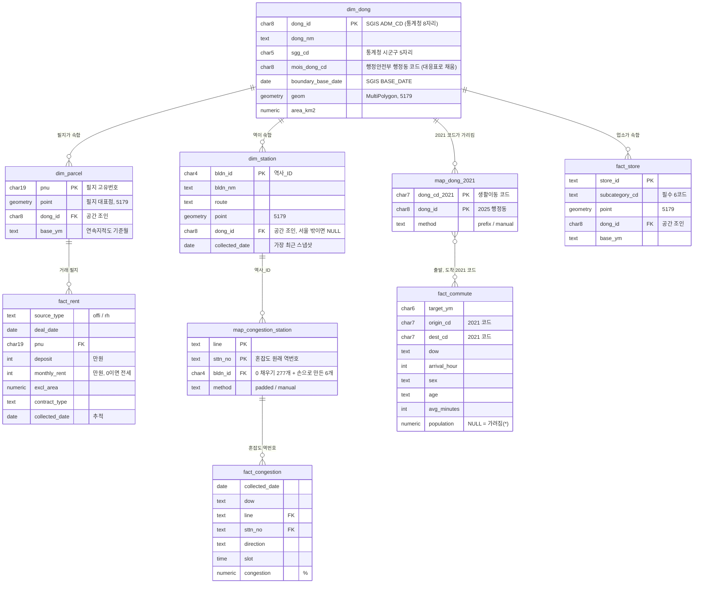

# 웨어하우스 ERD (단계 5, 초안)

상태: **승인됨 (2026-10-21).** 결정 12(데이터 상품, 받는 쪽은 부동산 플랫폼)와 결정 13(2025 경계 + 행정안전부 코드, 분동은 평균값 복사)을 따른다.

## 원칙
- 스키마: 스테이징 `stg` → 웨어하우스 `wh` → 마트 `mart`(단계 9).
- **좌표계는 하나로 맞춘다: 웨어하우스의 모든 도형은 EPSG:5179(SGIS 경계와 같음).** 경위도(역사마스터, 상가정보)와 EPSG:5186(연속지적도)은 적재할 때 변환한다.
- 중심은 행정동 차원 `wh.dim_dong` 하나다(순응 차원). 모든 팩트는 결국 이 차원의 `dong_id`로 모인다.
- **생활이동은 2021 코드 그대로 팩트에 둔다.** 2025 행정동으로 옮기는 일은 마트에서 대응표로 한다. 팩트 단계에서 옮기면 분동된 동의 이동 인구를 복사하게 되어 합계가 두 배가 된다.

## 그림

## 테이블마다 한 행의 뜻 (grain)
| 테이블 | 한 행 | 어디서 오나 |
|---|---|---|
| `wh.dim_dong` | 2025년 SGIS 기준 서울 행정동 하나 (426행 예상) | SGIS 경계 + 통계청↔행정안전부 대응표 |
| `wh.map_dong_2021` | 2021 생활이동 코드 하나와 2025 행정동 하나의 짝. 분동된 동은 2행 | 앞 7자리 규칙 418행 + 손으로 2021 코드 6개, 8행(오류2동·상일동은 분동이라 2행씩) (data_sources.md 10절) |
| `wh.dim_parcel` | 서울 필지 하나 | 연속지적도 (896,692행) |
| `wh.dim_station` | 역(호선별) 하나, 가장 최근 스냅샷 | stg.station_master |
| `wh.map_congestion_station` | 혼잡도의 (호선, 역번호) 하나와 역사_ID의 짝 | 0 채우기 + 손으로 6개 |
| `wh.fact_rent` | 신고된 전월세 계약 한 건 (오피스텔, 연립다세대) | stg.rent + dim_parcel |
| `wh.fact_commute` | 대상연월 × 출발 × 도착(2021 코드) × 요일 × 도착시간 × 성별 × 나이 하나 | stg.living_migration |
| `wh.fact_congestion` | 수집일 × 요일 × 호선 × 역 × 방향 × 30분 구간 하나 | stg.congestion |
| `wh.fact_store` | 필수 6코드 업소 하나, 기준월 하나 | stg.sbiz_store |

## 이 ERD에서 정하지 않은 것 (DDL 단계에서)
- (정함, 결정 15) 공간 조인이 들어가는 dim_parcel, dim_station, fact_store, dim_dong은 테이블. fact_rent, fact_commute, fact_congestion은 스테이징 위의 뷰.
- 필지 대표점과 행정동 "중심"을 무엇으로 할지(무게중심 vs 도형 안 대표점). 오목한 도형은 무게중심이 도형 밖에 있을 수 있다.
- fact_rent에서 여러 수집일에 같은 거래가 다시 나오는 문제(단계 6 증분 적재).
- 혼잡도 6개 역(9001~9006, 260)을 어느 역사_ID에 잇는지.
