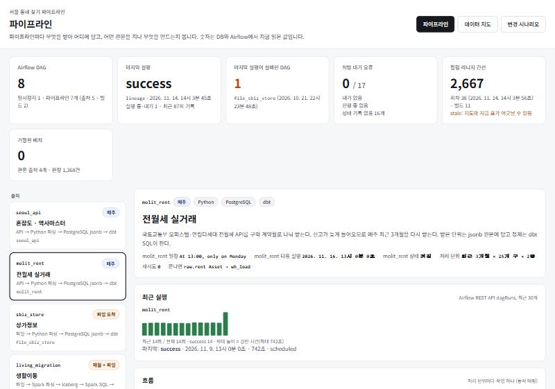
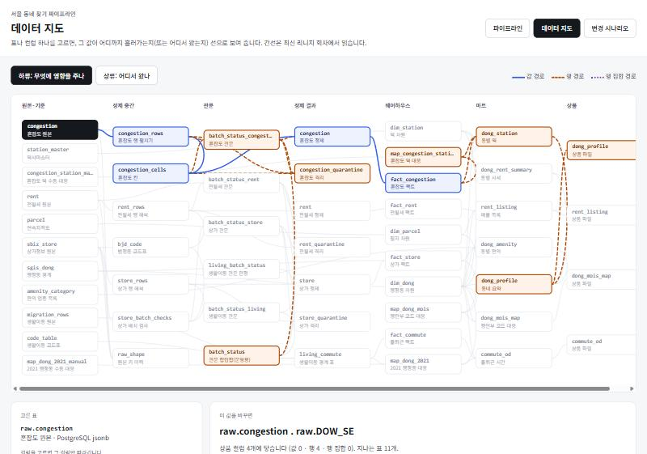
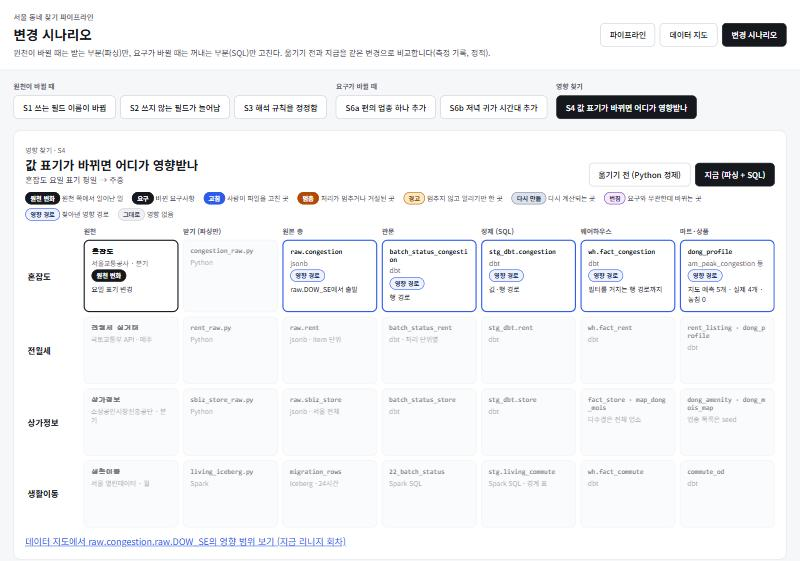

# 파이프라인 UI (결정 106)

사람이 파이프라인을 보는 읽기 전용 화면이다. 파이프라인마다 구조, 실행 상태, 관문 판정, 품질, 오류 기록, 컬럼 리니지를 DB와 Airflow에서 그때그때 읽어 보여 준다. 구현 지시는 `docs/handoff_ui.md`, 시각 설계 원본은 `Claude outputs/ui_reference/`의 캔버스 3화면이다.





## 구조

```
브라우저 127.0.0.1:8090
  ui/static/index.html  (한 파일, 일반 JS + SVG, 해시 주소 #/p · #/map · #/scenarios)
        │ GET만
        ▼
컨테이너 ui  (이미지 seoul-airflow:3.3.2의 FastAPI·uvicorn, 512m, cpu 1, 레포를 읽기 전용으로 붙임)
  ui/app.py ──┬─ PostgreSQL (역할 ui_reader, 읽기 전용 트랜잭션, 쿼리 15초·잠금 3초 상한)
              │     쿼리는 모두 ui/queries.sql에 이름을 붙여 모음
              ├─ Airflow REST API v2 (요청마다 /auth/token으로 토큰, 메타 DB 표는 읽지 않음)
              ├─ docs/failure_analysis.md  (ui/failures.py: F 번호, 제목, 마지막 상태 줄)
              └─ ui/pipelines.toml  (손으로 쓴 메타데이터: 파이프라인 정의, 지도 배치, 변경 시나리오)
```

응답마다 `sources[]`(출처 이름, 읽은 시각, 성공 여부, 실패 사유)가 붙는다. 출처 하나가 실패해도 나머지는 그려지고, 실패한 자리와 화면 아래 "이 숫자는 어디서 왔나" 표에 사유가 나온다.

## 화면별 데이터 출처

| 화면 | 요소 | 출처 (`sources[].name`) |
|---|---|---|
| 파이프라인 | 개요: DAG 수, 일시정지, 마지막 실행, 마지막 실행이 실패한 DAG | `airflow:/api/v2/dags`, `airflow:/api/v2/dags/~/dagRuns` (최근 100건) |
| | 개요: 처방 대기·진행 중 오류 | `docs/failure_analysis.md` |
| | 개요: 리니지 간선, 회차, stale | `lineage_status` (lineage.run, lineage.latest_build, lineage.edge) |
| | 개요: 거절된 배치, 관문 출처 수 | `batch_rejected` (stg_dbt.batch_status) |
| | 목록: 이름, 흐름, 트리거, 일시정지, 일정 어긋남 | `ui/pipelines.toml` + `airflow:/api/v2/dags` |
| | 상세: 일정, 다음 실행, 상태 | `airflow:/api/v2/dags` |
| | 상세: 최근 실행 막대(상태, 걸린 시간) | `airflow:/api/v2/dags/{dag}/dagRuns` (최근 30개) |
| | 상세: 관문 판정(수집일마다) | `batch_detail` (stg_dbt.batch_status) |
| | 상세: 품질과 신선도 | `quality` (ops.quality), `freshness` (ops.freshness) |
| | 상세: 빌드 기록 / 엔진 실행 / 리니지 회차 | `build_runs` (ops.build_run, ops.build_diff) / `engine_runs` (ops.engine_run) / `lineage_runs` (lineage.run) |
| | 상세: 흐름 레인, 정의(폼·JSON), 증명과 측정, 관련 시나리오 | `ui/pipelines.toml` |
| | 상세: 기록된 오류 | `docs/failure_analysis.md` (toml의 F 번호로 찾음, 없으면 "없음"으로 표시) |
| 데이터 지도 | 표·컬럼 노드, 간선 | `lineage_edges` (lineage.edge, 최신 성공 회차) + `ui/pipelines.toml` [map] (층 배치, 이름표) |
| | 고른 컬럼의 영향 범위 | `impact_down` / `impact_up` (lineage.downstream / upstream, 리니지 MCP와 같은 뷰) |
| | 변이 시험으로 확인한 실제 영향 | `ui/pipelines.toml` [map.mutations] (측정 31, 35) |
| 변경 시나리오 | 전체 | `ui/pipelines.toml` [scenarios] (정적, 측정 번호와 함께) |

API: `/api/overview`, `/api/pipelines`, `/api/pipelines/{id}`, `/api/lineage/graph`, `/api/lineage/impact?table=&column=&direction=down|up`(column을 빼면 표 전체), `/api/failures`, `/api/scenarios`. 모두 GET이다.

## 실행

병합 뒤:

```bash
docker compose exec -T db psql -U seoul -d seoul -v ON_ERROR_STOP=1 -v ui_pw=<.env의 UI_READER_PASSWORD> < warehouse/sql/13_ui_reader.sql
docker compose up -d ui
```

http://127.0.0.1:8090 을 연다. 코드를 고치면 `docker restart new_proj-ui-1`(uvicorn 자동 재시작을 켜지 않았다).

병합 전(worktree `../new_proj_ui`, 브랜치 `ui`)에는 기존 스택(`new_proj`)에 `ui` 컨테이너 하나만 붙인다. db와 Airflow는 건드리지 않는다.

```bash
docker compose -p new_proj --env-file ../new_proj/.env --env-file .env up -d --no-deps ui
```

`.env`(worktree, git 제외)에는 `UI_READER_PASSWORD` 한 줄만 있다. 병합할 때 메인 `.env`로 옮긴다.

시험(DB 없이, CI 이름 규칙 안): `python -m tests.test_ui_failures`, `python -m tests.test_ui_pipelines`.

## 확인한 것 (2026-11-14)

| 지시서 기준 | 결과 |
|---|---|
| U1: `/api/overview` 값이 DB·Airflow와 같다 | 리니지 회차 37·간선 2,667·빌드 10, 거절 배치 0, DAG 8·일시정지 2를 직접 조회와 대조(그 시점 값) |
| U2: toml 일정을 틀리면 시험이 실패한다 | `molit_rent`를 `0 14 * * 1`로 바꾸면 `molit_rent 일정: 코드 '0 13 * * 1' / toml '0 14 * * 1'`로 실패, 되돌리면 통과 |
| U3: 캔버스 Pipelines와 같은 구성 | 7개 파이프라인 상세를 모두 열어 출처 실패 0. 캔버스의 지금 상태 숫자는 모두 쿼리 값으로 바뀜 |
| U4: `stg_dbt.congestion.dow`의 영향이 리니지 MCP와 같다 | MCP `downstream`과 `/api/lineage/impact`가 같은 7행(wh.fact_congestion.dow 값, mart.dong_station·mart.dong_profile·product.dong_profile의 am_peak_congestion 행, 세 표의 `*` 행 집합). 더해서 화면의 그림(walk)과 DB 뷰를 표 52개의 모든 컬럼과 표 전체, 양방향 1,198개 조합에서 대조해 차이 0(판단 U-17) |
| U6: DB나 Airflow 토큰이 틀리면 어느 출처가 실패했는지 보인다 | 별도 컨테이너(포트 8091)에서 DB 주소를 없는 호스트로, Airflow 토큰을 틀린 값으로 바꿔 띄움. 모든 API가 200으로 답하고 `sources[]`에 `403 Forbidden`, `failed to resolve host`, `건너뜀`이 남음. 화면은 실패한 자리마다 사유를 보이고, toml·문서에서 온 부분은 그대로 그림(판단 U-19) |
| 완료 기준: index.html에 측정 숫자가 없다 | `grep -noE "[0-9][0-9,.]{2,}" ui/static/index.html`의 결과는 CSS 값, 단위 변환(1000), 판단 번호 주석뿐 |
| U-4의 남은 확인: 다음 wh_load 뒤에도 stg_dbt를 읽는다 | 빌드 11(2026-11-14 14:03 KST, 스키마 교체) 뒤 `ui_reader`로 `stg_dbt.batch_status` 1,368행, `wh.dim_dong` 426행을 읽음. DELETE는 읽기 전용 트랜잭션으로 거절 |

## 측정 (병합 때 measurements.md로)

조건: Ryzen 7 7800X3D, Windows 11, Docker Desktop, `ui` 컨테이너(512m, cpu 1) 안 또는 호스트 curl, 각 1회.

| 무엇 | 값 |
|---|---|
| `ops.quality`의 생활이동 줄(격리 표 3,193만 행 count), 데운 상태 | 2.65초 |
| 같은 뷰의 행정동 경계·연속지적도 줄 | 0.43초 |
| `lineage.downstream`에서 컬럼 하나 거르기 | 0.16초 |
| Airflow dagRuns 30개 | 0.35초 |
| 생활이동 상세 API 전체(데운 상태) | 2.6초 |
| 없는 DB 호스트로 연결 실패 1회 | 3.85초 |
| 깨진 인스턴스 `/api/overview` / 전월세 상세: 연결 실패 건너뛰기 전 → 뒤 | 7.7초 → 4.2초 / 11.6초 → 3.9초 |
| 그림과 DB 뷰 대조 1,094조합(브라우저 안, 8개씩 동시) | 40초 |
| `ui` 컨테이너 메모리(U1) | 61.8MiB |

## UI 결정

병합할 때 `docs/decisions.md`의 다음 번호로 옮긴다(J-18).

### UI 결정 1. 파이프라인 메타데이터는 yaml이 아니라 toml
- 상황: 지시서는 `ui/pipelines.yaml`과 그것을 실제 DAG와 대조하는 시험을 CI에서 돌리라고 했다. CI는 `requirements.txt`만 설치하는데 PyYAML이 없다.
- 선택지: (A) PyYAML 추가: 지시서 6절의 새 패키지 금지에 걸린다. (B) JSON: 표준 라이브러리지만 주석이 없어 손으로 쓰는 메타데이터에 근거를 적을 수 없다. (C) toml: Python 3.11부터 표준 라이브러리 `tomllib`, 주석 지원. 대신 인라인 표가 한 줄이어야 해서 시나리오 칸이 긴 줄이 된다.
- 결정과 이유: C. 새 의존성 없이 CI에서 시험이 돈다.
- 검증: 어긋남 시험이 CI와 같은 패키지(`.venv`)에서 통과, 일정 하나를 틀리면 실패(U2).
- 결과와 남은 것: 파이프라인 정의, 지도 배치, 시나리오가 한 파일에 있다. 시험은 일정만 본다(Asset 이름과 작업 구성은 보지 않음).

### UI 결정 2. 지도의 경로 종류는 리니지 DB 뷰의 정의를 따른다
- 상황: 캔버스의 walk는 `*`(행 집합) 노드에 닿거나 거기서 출발하면 경로 종류를 무조건 "행 집합"으로 올렸다. 지시서의 확인 기준은 화면의 영향 범위가 리니지 MCP와 같은 것이다.
- 선택지: (A) 캔버스 규칙 유지, 영향 목록만 DB 뷰에서: 그림과 목록이 서로 다른 답을 낸다. (B) walk가 간선 종류만 따르게 바꾼다: 그림, 목록, MCP가 한 정의를 쓴다.
- 결정과 이유: B. 같은 질문에 화면 두 곳이 다르게 답하면 어느 쪽을 믿을지 사람이 판단해야 한다.
- 검증: A는 1,094조합 중 282개에서 경로 종류가 달랐고(닿는 컬럼 자체는 모두 같음), B는 표 전체를 더한 1,198조합에서 차이 0. 화면은 고를 때마다 그림과 목록을 대조해 결과를 한 줄로 보인다.
- 결과와 남은 것: `*`에 INDIRECT 간선으로 닿으면 "행"으로 보인다. 그것이 맞는 해석인지는 리니지 추출기(결정 80)의 문제로 남긴다.

### UI 결정 3. 화면 요청은 기다림에 상한을 두고, DB에 닿지 못하면 나머지 DB 읽기를 건너뛴다
- 상황: 생활이동 상세를 처음 열었을 때 요청이 한동안 끝나지 않았다. DB가 멈춘 상태를 흉내 내면 연결 실패 한 번이 3.85초였고, DB 출처가 셋인 상세는 11.6초 동안 빈 화면이었다.
- 선택지: (A) 그대로. (B) 쿼리 시간 상한만. (C) 상한에 더해, 한 요청에서 연결 단계가 실패하면(sqlstate 없음, 08, 28) 나머지 DB 읽기를 건너뛰고 "건너뜀"으로 남김. 상세 요청은 개요와 동시에 보내고, 읽는 동안 "읽는 중"을 보임.
- 결정과 이유: C. 실패는 드러나되 빨리 드러나야 한다(설계 원칙 4). 쿼리 시간 초과와 잠금 대기는 그 쿼리만의 실패라 건너뛰지 않는다.
- 검증: 깨진 인스턴스에서 7.7초 → 4.2초, 11.6초 → 3.9초. 시간 초과(`pg_sleep(16)`) 뒤의 읽기는 성공, 틀린 비밀번호 뒤의 읽기는 건너뜀.
- 결과와 남은 것: 연결 실패 3.85초 자체는 그대로다(이름 찾기 시간). 요청 안의 출처를 동시에 읽으면 더 줄지만 지금 규모에선 하지 않았다.

## 판단 기록

`docs/judgment_log.md` 대신 여기에 적는다. 메인 세션이 같은 파일에 쓰고 있어 병합 충돌을 피하려는 것이고, 병합 때 옮긴다.

- **U-1. 메인 1절 커밋 전에 worktree를 만들었다 (2026-11-14, 사용자 "지금 환경에 맞춰 판단").** HEAD 3efb02f에서 만들었다. UI가 고치는 추적 파일은 `docker-compose.yml` 하나이고 나머지는 새 파일이다. 줄바꿈 정규화 커밋과 겹치는 파일은 compose 하나뿐이라, 병합 전 rebase로 푼다(J-18). 대가: worktree의 `docs/failure_analysis.md`는 커밋된 판(F-1~F-17)이라, 병합 전까지 화면의 오류 목록은 메인 작업 트리(F-20까지)보다 늦다.
- **U-2. 역할 파일 번호는 13.** 지시서의 `09_ui_reader.sql`은 `09_raw_congestion.sql`과 겹친다. 다음 빈 번호를 썼다.
- **U-3. 오류 상태는 문서에 있는 것만 읽는다(선택지 A).** `- 상태:`(또는 `- 상태 갱신 (...):`) 줄의 마지막 것을 쓰고, 없으면 `status=None`으로 두어 화면에 "상태 기록 없음"으로 보인다. 메인 작업 트리 기준 20개 중 10개가 상태 줄이 없다. 문서에 줄을 더하는 B는 메인 세션이 같은 파일을 고치는 중이라 고르지 않았다. 대기 판정은 낱말로: '대기'와 '진행 중'. U1 실행 중에 메인 세션이 F-1을 "우회 유지", F-9·F-20을 "처방 결정됨, 진행 중"으로 바꿨고, 마지막 줄 규칙대로 읽혔다.
- **U-4. `ui_reader`는 lineage, ops, stg_dbt 스키마 전체와 seoul의 기본 권한을 받는다.** 지시서는 표 단위를 뜻했지만 두 가지가 막았다.
  - `ops.quality`의 `ops.row_count()`는 호출자 권한으로 `stg_dbt` 표를 센다.
  - `stg_dbt`는 wh_load마다 스키마째 바꿔 끼운다(swap_schemas). 실제로 U1 도중 메인 세션의 wh_load(빌드 10, 10:45 KST)가 끝나자 `stg_dbt` USAGE가 사라졌고, `/api/overview`가 `batch_rejected: InsufficientPrivilege`를 드러냈다. 기본 권한(metabase_ro와 같은 방식)을 넣기 전에 빌드 스키마가 이미 만들어져 있었던 것으로 본다. 역할 파일을 다시 돌려 고쳤다.
  - 한계: 기본 권한은 스키마를 가리지 못해 다음 빌드부터 wh·mart도 읽게 된다. 연결은 `default_transaction_read_only`라 쓰기는 막힌다.
  - 확인(U7): 빌드 11(2026-11-14 14:03 KST)의 스키마 교체 뒤에도 `stg_dbt`를 읽는다. 예상대로 `wh`도 읽힌다. DELETE는 거절.
- **U-5. Airflow 토큰은 매 요청 `GET /auth/token`으로 받는다(J-16).** all-admins 모드라 토큰 없이도 API가 열리지만(U0: 없음 200, 틀림 403) 붙인다. 로그인을 켜면 `ui/app.py`의 `airflow()` 한 곳만 바꾼다.
- **U-6. 출처별 실패 표시를 U1에 넣었다.** "이 숫자는 어디서 왔나"(출처 이름, 읽은 시각)를 남기는 같은 자리에서 성공 여부와 오류를 남긴다. 화면 표시와 일부러 깨 보는 확인은 U6에서 한다.
- **U-7. 정의 파일의 숫자 규칙.** 캔버스 Pipelines의 지금 상태 숫자(행 수, 실행 횟수, 회차, 마지막·다음 실행, "10개 달 모두 승인")는 정의 파일에서 뺐다. 화면이 DB와 Airflow API에서 읽는다(U3). 과거 측정 결과(proofs)는 측정 번호와 함께 남겼다. 측정 기록은 바뀌지 않는 사실이고, 원본은 measurements.md다. 완료 기준의 "하드코딩 0"은 index.html 기준이다.
- **U-8. `pipelines.yaml` 대신 `pipelines.toml`.** CI는 `requirements.txt`만 깔고, 거기에 PyYAML이 없다(프로젝트 `.venv`에도 없음을 확인). 어긋남 시험은 CI에서 돌아야 하므로 새 패키지를 넣거나(6절 금지) 다른 형식을 써야 했다. Python 3.11부터 표준 라이브러리인 `tomllib`은 주석을 지원해 손으로 쓰는 메타데이터에 맞다. JSON은 주석이 없어 고르지 않았다.
- **U-9. 파이프라인 7개, DAG 8개.** 캔버스처럼 `file_sgis_boundary`와 `file_parcel_boundary`를 한 파이프라인(boundary)으로 묶고, 파이프라인마다 `dags` 표에 DAG와 일정을 적었다. 오류 번호는 캔버스 것에 둘을 더했다: 전월세 F-2(raw.rent 기본 키), 생활이동 F-20(무거운 실행의 디스크). 관계가 분명하지 않은 F-1, F-14, F-15, F-17, F-18은 어느 파이프라인에도 붙이지 않았다. 개요의 전체 목록에는 나온다.
- **U-10. 어긋남 시험은 DAG 파일을 가짜 Airflow 모듈로 실제 실행한다.** 글자 파싱(ast)은 `file_sources.py`처럼 반복문으로 만드는 DAG를 못 잡는다. `airflow`, `pendulum`을 `unittest.mock`으로 바꾸고 `DAG(...)` 인자만 모은다. 확인한 것: worktree DAG 8개와 일치, 메인 작업 트리의 고친 DAG 파일과도 일치, `molit_rent` 일정을 `0 14 * * 1`로 틀리면 실패, CI와 같은 패키지(`.venv`)에서 통과. 한계: 일정 값만 본다. Asset 이름이나 DAG 안의 작업 구성은 보지 않는다.
- **U-11. `/api/pipelines`는 toml 일정과 Airflow가 실제로 쓰는 일정도 비교한다(`schedule_matches`).** 시험은 코드와 toml을 비교하고, 이 값은 toml과 지금 돌고 있는 Airflow를 비교한다. 코드를 고친 뒤 Airflow가 아직 다시 읽지 않은 상태가 여기서 드러난다. Airflow를 못 읽으면 `in_airflow`를 비워 둔다. "없음"으로 단정하지 않는다.
- **U-12. 상세 화면이 어느 DB 출처를 볼지는 `pipelines.toml`에 적는다.** `stg_dbt.batch_status`의 source는 영문(congestion, rent, store, living), `ops.quality`·`ops.freshness`의 source는 한글(혼잡도, 전월세 등)이라 코드에서 이름을 이어 붙일 수 없다. 파이프라인마다 `batch_sources`, `ops_sources`, `records`(실행 기록 쿼리 이름)를 두었다. 관문 판정은 1,352배치(전월세)를 그대로 보내지 않고 수집일마다 묶는다(`batch_detail`).
- **U-13. UI의 DB 연결에 시간 상한을 둔다(`statement_timeout=15s`, `lock_timeout=3s`).** 브라우저로 생활이동 상세를 처음 열었을 때 요청이 한동안 끝나지 않았다. 다시 재 보니 `ops.quality`의 생활이동 줄이 데워진 상태에서도 2.65초다(격리 표 `stg.living_quarantine` 3,193만 행 count, `ui` 컨테이너 안에서 1회). 멈춘 원인이 차가운 캐시인지 메인 세션 실행의 잠금인지는 확인하지 못했다 [확인 필요]. 그때 잠금은 이미 없었다. 어느 쪽이든 화면 요청이 무거운 작업 뒤에 줄 서면 안 되므로, 상한을 넘으면 그 출처만 `QueryCanceled`로 드러나게 했다(`pg_sleep`으로 확인).
- **U-14. 리니지 상세의 실행 기록은 `ops.engine_run`이 아니라 `lineage.run`이다.** 지시서 3절은 엔진 지표(생활이동, 리니지)를 `ops.engine_run`에서 읽으라고 했지만, 그 표에는 생활이동의 Spark·DuckDB 실행 7개만 있고 리니지 실행은 없다. 리니지는 회차마다 `lineage.run`(엔진, SQL 파일 수, 간선 수, 걸린 시간)에 남으므로 그것을 보인다.
- **U-15. 개요 카드는 지시서 3절 목록대로 만든다.** 캔버스의 "정제를 SQL로 옮긴 출처 4 / 7"은 지시서 목록에 없고 읽을 곳도 없는 정적 사실이라 뺐다. "배치 관문이 있는 출처"는 `batch_status`에서 센 출처 수로 거절 배치 카드에 합쳤다. 캔버스가 불러오던 Google Fonts는 넣지 않았다(외부 요청 없이 시스템 글꼴).
- **U-16. 캔버스에서 옮겨 온 버그 하나를 고쳤다.** 캔버스의 JSON 보기는 `{pipeline, trigger, engines}` 뒤에 정의 절을 펼치는데, wh_load와 lineage는 정의에 `trigger` 절이 있어 맨 위 `trigger: "Asset"`을 덮어쓴다. 맨 위 키를 `trigger_label`로 바꿨다.
- **U-17. 지도의 walk에서 캔버스의 `*` 강제 규칙을 뺐다(UI 결정 2).** 처음엔 캔버스 그대로 옮기고 영향 목록만 DB 뷰에서 읽었는데, 화면이 고를 때마다 하는 대조에서 어긋남이 나왔다. 브라우저 안에서 표 52개의 모든 컬럼 × 양방향 1,094조합을 돌려 보니 282개가 달랐고, 차이는 모두 `*` 노드의 경로 종류였다(닿는 컬럼 수는 모두 같음). 간선 종류만 따르게 바꾼 뒤 표 전체 선택까지 더한 1,198조합에서 차이 0.
- **U-18. 연결 단계 실패만 건너뛰기 대상이다(UI 결정 3).** psycopg에서 쿼리 시간 초과(`QueryCanceled`, 57014)와 잠금 대기(55P03)도 `OperationalError`의 하위라, 예외 종류만 보면 DB가 살아 있는데도 나머지를 건너뛰게 된다. sqlstate가 없거나(클라이언트에서 연결 못 함) 08(연결), 28(인증)일 때만 건너뛴다.
- **U-19. U6은 공용 DB를 멈추지 않고 별도 컨테이너로 확인했다.** 지시서는 "DB를 멈추거나"라고 했지만 메인 세션이 같은 DB에서 생활이동 실행과 wh_load를 돌리는 중이었다(빌드 11이 U7 중에 끝남). 같은 이미지와 같은 코드(읽기 전용 마운트)로 포트 8091에 하나 더 띄우고, DB 주소를 없는 호스트(`db-stopped`, 컨테이너가 멈추면 이름이 사라지는 것과 같은 상태)로, Airflow 토큰 발급만 틀린 값을 돌려주게 바꿨다(나머지 Airflow 호출은 실제로 보내 403을 받음). 제품 코드는 고치지 않았다. 확인 뒤 컨테이너를 지웠다. 한계: 실행 중에 DB가 끊기는 경우(연결은 됐다가 끊김)는 보지 않았다. UI API 서버 자체가 죽은 경우는 화면의 `get()`이 출처 표에 URL과 오류를 남기는 코드만 있고 실제로 죽여 보지는 않았다.
- **U-20. 시나리오 데이터의 '지금 구조' 칸에서 현재 행 수를 뺐다(U-7과 같은 규칙).** 예: `raw.congestion`의 "jsonb · 수집일당 1,671행" → "jsonb", `stg_dbt.congestion`의 "dbt · 325,845행" → "dbt". 옛 구조 칸("6코드만 → stg.sbiz_store 30,394행" 등)과 전후 비교, 근거의 숫자는 측정 결과라 남겼다. 시나리오 S4는 데이터 지도로 바로 가는 링크를 붙여 측정 당시 예측(5개)과 지금 회차의 답을 나란히 볼 수 있게 했다.
- **U-21. 표 52개의 층 배치와 이름표는 캔버스 값을 그대로 toml로 옮겼다.** 지금 회차의 표 목록과 캔버스 목록이 52개로 같았다. 새 표가 생기면 화면이 맨 오른쪽 '분류 안 됨' 열과 경고 줄로 드러낸다(API `unmapped`).
